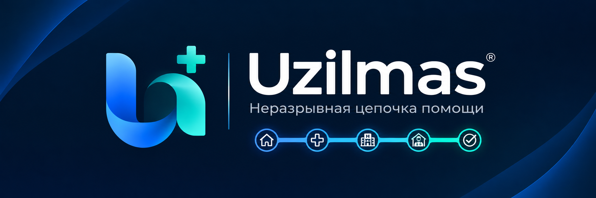
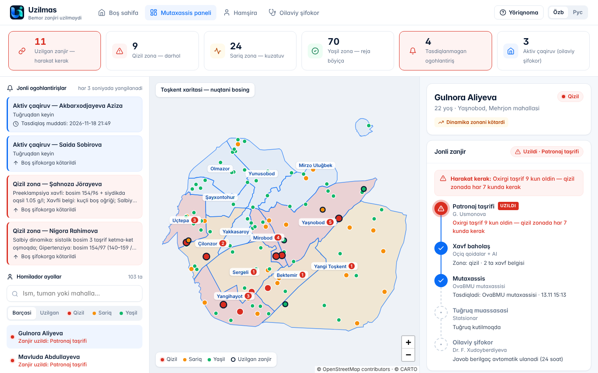
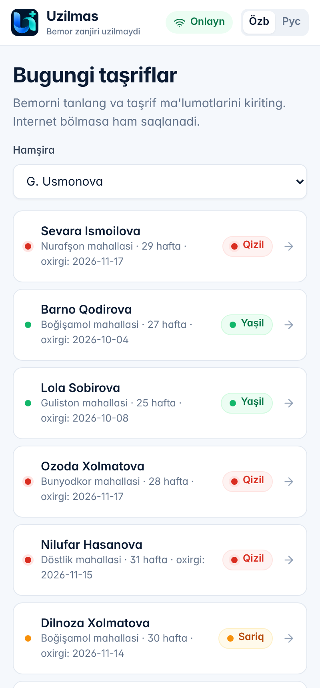
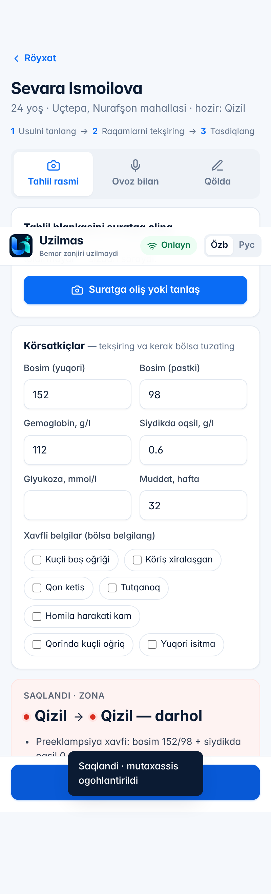
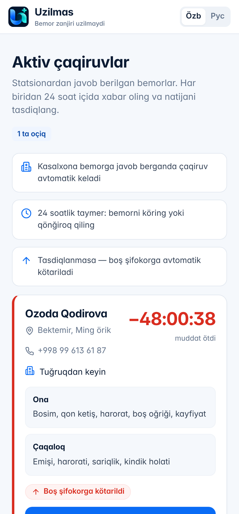
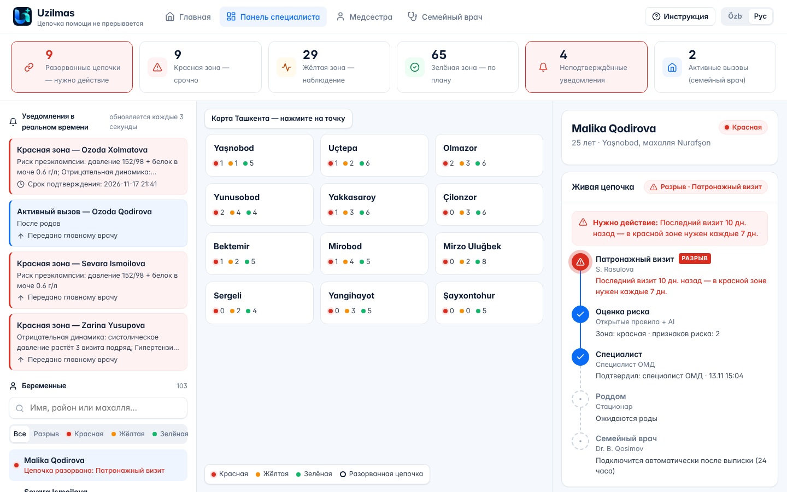
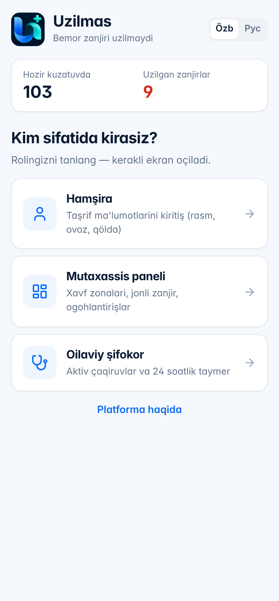
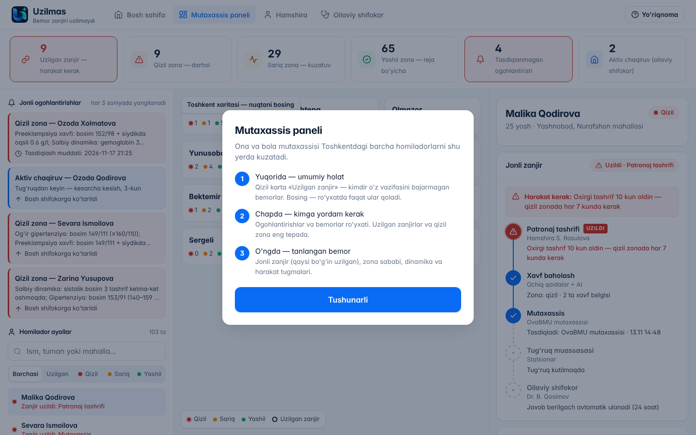

# Uzilmas



**Bemor tizimdan tuşib qolmaydi.** · *The unbroken chain of care.*
Homilador ayolni patronaj hamşirasidan tortib oilaviy şifokorgaça bitta uzluksiz zanjirda kuzatadigan platforma.

Umummilliy AI Xakaton — Toşkent, 2026 · Soğliqni saqlaş vazirligi muammolari **№9, №10, №11**



## Asosiy imkoniyat — Jonli zanjir
Har bir bemor uçun 5 böğin: **Patronaj → Xavf baholaş → Mutaxassis → Tuğruq muassasasi → Oilaviy şifokor**.
Böğin kök — bajarildi, sariq — javob kutilmoqda (taymer), qizil **UZILDI** — kim, qaçon, nima qilmagani körsatiladi.
Panel uzilgan zanjirlarni birinçi körsatadi; zanjir uzilsa ovozli signal, tiklansa xabar. Kod: [`backend/app/chain.py`](backend/app/chain.py).


## Til va alifbo · Язык и алфавит
- Interfeys **2 tilda**: özbekça (**yangi lotin alifbosi** — O‘RQ–1184 qonuni: Ö, Ğ, Ş, Ç) va **ruscha**. Almaştiriş — yuqori öng burçakda «Özb / Рус».
- Ovozli kiritiş amaldagi va yangi alifboni, hamda rus tilini tuşunadi (`backend/app/alphabet.py`).

## Telegram Mini App
1. Botni @BotFather da yarating, tokenni `.env` ga yozing (`TELEGRAM_BOT_TOKEN`).
2. Serverga HTTPS manzil bering (Telegram talabi). Eng oson yöl — **cloudflared**:
   ```
   cloudflared tunnel --url http://localhost:8000
   ```
   U `https://xxxx.trycloudflare.com` manzilini beradi.
3. Uni `.env` ga yozing: `WEBAPP_URL=https://xxxx.trycloudflare.com` va serverni qayta işga tuşiring.
4. Botda `/start` — «📱 Uzilmas ilovasini oçiş» tugmasi va çap pastdagi menyu tugmasi paydo böladi.
   Mini App rol tanlaş ekranidan boşlanadi (`/app`), Telegram tili rus bölsa — interfeys avtomatik ruscha.

## Muammo → Yeçim
| № | Vazirlik muammosi | Uzilmas |
|---|---|---|
| **10** | Qişloqda internet yöq, ma'lumot raqamli tizimga kirmaydi | Hamşira ilovasi **offline** işlaydi, **tahlil rasmi** yoki **özbekça ovoz** bilan kiritiş |
| **9** | Homiladorlar holati real vaqtda kuzatilmaydi, mutaxassis keç biladi | AI **rangli zonalar** 🟢🟡🔴 + izoh + dinamika, qizil zona → **Telegram**, javob bölmasa → **eskalatsiya** |
| **11** | Javob berilgandan keyin oilaviy şifokor xabar topmaydi | "Javob berildi" → oilaviy şifokorga **Aktiv çaqiruv**, **24 soat** taymer, tasdiqlanmasa → boş şifokor |

```
📷 Tahlil / 🎤 Ovoz / 📴 Offline  →  🧠 Oçiq qoidalar + AI  →  🔴 Telegram  →  ⏫ Eskalatsiya  →  Oilaviy şifokor (24 soat)
```

## Xavfsizlik tamoyili
> **Zonani oçiq qoidalar belgilaydi. AI faqat öqiydi va tuşuntiradi. AI xavotirni kötara oladi, lekin bekor qila olmaydi.**

- Har bir qoida: ID, daraja, manba → [`backend/app/rules.py`](backend/app/rules.py), `GET /api/rules`
- AI işonçi < 70% yoki qiymat mantiqsiz → **"tekşiring"**, heç qaçon "norma" emas
- Muhim körsatkiç noma'lum → yaşil zona berilmaydi
- AI heç narsani özi saqlamaydi — hamşira tasdiqlaydi
- Blankadagi ism bemor ismiga mos kelmasa → ogohlantiriş
- Offline rejimda ham oğir holatlar uçun "103 ga qönğiroq qiling" xavfsizlik töri

## Işga tuşiriş
**Mac/Linux:** `./run.sh` · **Windows:** `run.bat` → http://127.0.0.1:8000

Qölda:
```bash
cd backend
pip install -r requirements.txt
cp .env.example .env            # GEMINI_API_KEY, TELEGRAM_* ni yozing
python -m app.seed              # 100 + 3 demo bemor (sintetik)
uvicorn app.main:app --host 0.0.0.0 --port 8000
python -m pytest -q             # 33 ta test
```

| Sahifa | Kim uçun |
|---|---|
| `/` | Boş sahifa: qanday işlaydi, modullar, jonli statistika |
| `/nurse` | Patronaj hamşirasi (telefon, offline, rasm, ovoz) — №10 |
| `/dashboard` | Mutaxassis paneli — OvaBMU mutaxassisi: xarita, zonalar, izohlar, jonli ogohlantirişlar — №9 |
| `/doctor` | Oilaviy şifokor: aktiv çaqiruvlar, 24 soat taymer — №11 |
| `/docs` | API hujjatlari |

## Xarita
Toşkentning 13 tumani çegaralari — **OpenStreetMap** (ODbL) maʼlumotlari, `frontend/tashkent_districts.geojson`. Tuman rangi — xavf indeksi (qizil zona + uzilgan zanjir). Leaflet kutubxonasi loyiha içida (`frontend/vendor/leaflet`) — internetsiz ham xarita va çegaralar körinadi; fon xarita (CARTO) internet bölsa yuklanadi.

## Texnologiyalar
FastAPI · SQLite · Gemini Vision (tahlil rasmi) · Aisha STT (özbek nutqi) · Telegram Bot API · PWA (service worker, offline navbat) · Leaflet

## Arxitektura
```
backend/app/
  rules.py     oçiq qoidalar: zona, izoh, manba, dinamika (AI emas!)
  extract.py   Gemini: tahlil rasmi -> raqamlar (işonç, birlik, oraliq tekşiruvi)
  voice.py     Aisha/Gemini: nutq -> matn -> raqamlar; özbekça sonlar ("yuz ellik ikki" -> 152)
  notify.py    Telegram xabarlar, "Qabul qildim" tugmasi, eskalatsiya, aktiv çaqiruv
  main.py      API + sahifalar
frontend/      index, nurse (PWA), dashboard, doctor
```

## Skrinşotlar
| Hamşira: röyxat | Hamşira: taşrif | Oilaviy şifokor |
|---|---|---|
|  |  |  |

| Ruscha interfeys | Telegram Mini App | Yöriqnoma |
|---|---|---|
|  |  |  |

## Keyingi bosqiçlar
1. Pilot: Toşkentning bitta tumani, 2–3 oilaviy poliklinika
2. DMED bilan API integratsiya
3. Yangi treklar: gipertoniya, diabet (xuddi şu platforma)
4. Qoidalarni Respublika perinatal markazi mutaxassislari bilan tasdiqlaş

⚠️ Prototip. Barça ma'lumotlar va blankalar sintetik (NAMUNA). Çegaralar amaliyotda qöllaşdan oldin akuşer-ginekolog tomonidan tasdiqlanişi şart. Tizim taşxis qöymaydi — şifokor qarorini qöllab-quvvatlaydi.

## Litsenziya · Open source
Kod — **MIT** litsenziyasi ostida oçiq ([LICENSE](LICENSE)). Uçinçi tomon komponentlari:
- **Leaflet** — BSD-2-Clause (`frontend/vendor/leaflet/LICENSE`)
- **Toşkent tumanlari çegarasi** — © OpenStreetMap contributors, **ODbL** (`frontend/tashkent_districts.geojson`)
- Klinik qoidalar — JSST tavsiyalari va milliy klinik protokollar asosida; tibbiy qaror qabul qiluvçi vosita emas, şifokorga yordamçi.

Barça bemor ma'lumotlari **sintetik**. Maxfiy kalitlar repozitoriyda saqlanmaydi (`.env` — `.gitignore` da).
