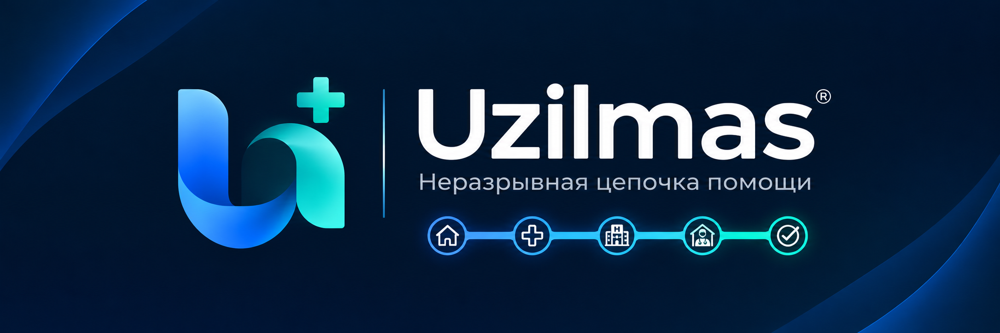
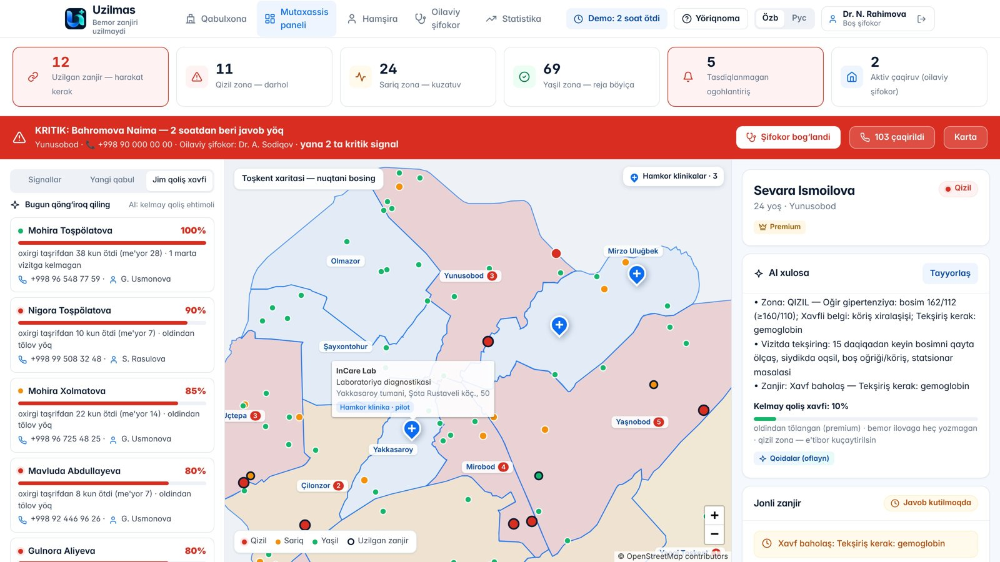
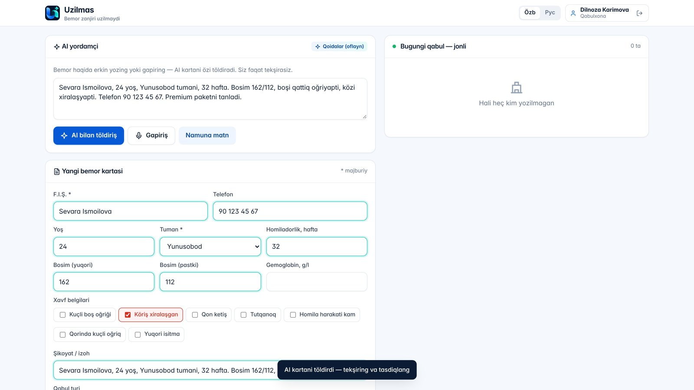
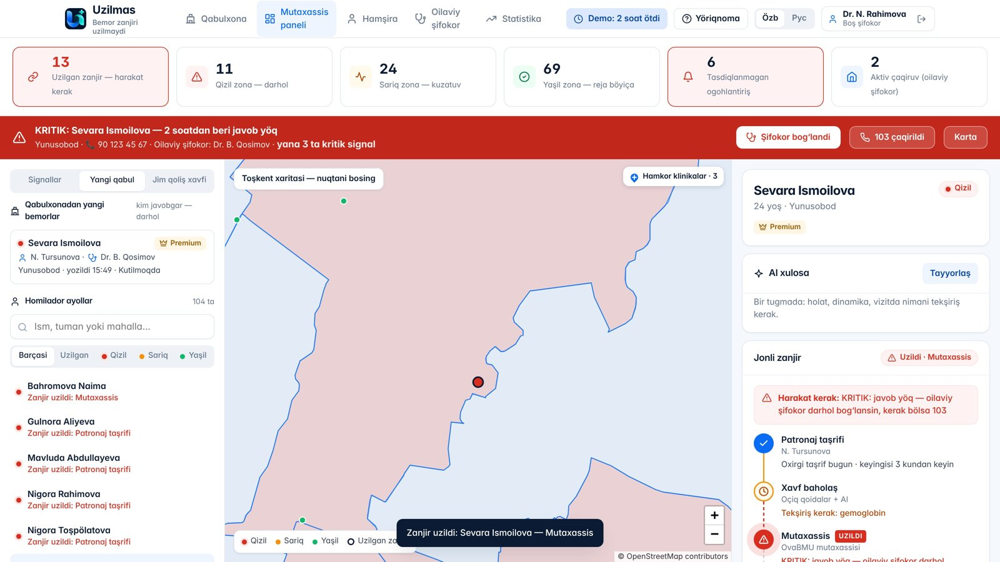
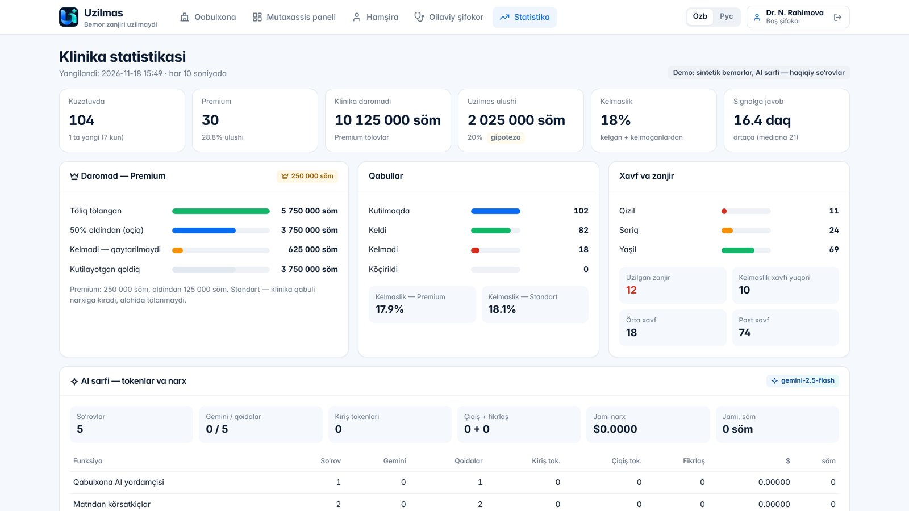
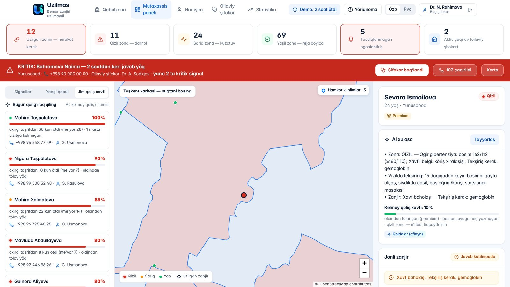
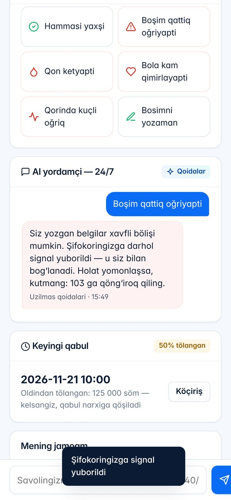
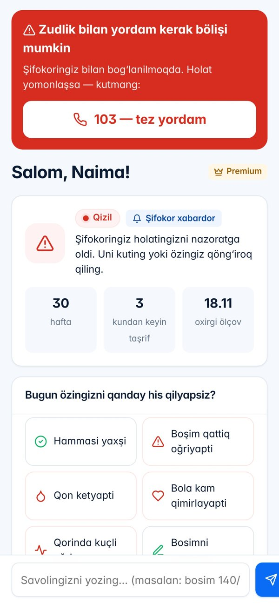

# Uzilmas



**Boşqalar eslatadi — Uzilmas kafolatlaydi.** · *The unbroken chain of care.*
Xususiy klinikalar uçun AI platforma: homilador ayol bir skriningdan keyin kuzatuvdan tuşib qolmaydi, xavf belgisi esa şifokorga 2 soat içida yetadi.

Milliy AI Xakaton — Toşkent, 2026 · Soğliqni saqlaş yönalişi



## Uç asosiy farq
1. **50% oldindan tölov** — Premium 250 000 söm, 125 000 söm oldindan: tölagan ayol keladi, kelmaslik kamayadi.
2. **2 soat → 103** — qizil signal 2 soat tasdiqlanmasa, oilaviy va boş şifokorga KRITIK xabar, ekranda 103 tugmasi.
3. **Javobgarlik jurnali** — har bir bemorda javobgar hamşira va şifokor; kim, qaçon, nima qilgani yozib boriladi.

## AI — 4 funksiya (Gemini 2.5 Flash)
| Funksiya | Kim uçun | Nima qiladi |
|---|---|---|
| Intake | Qabulxona | Bir gap (matn yoki ovoz) → bemor kartasi avtomatik töldiriladi |
| Triaj | Bemor | Şikoyatdan xavf belgisini topadi → qizil zona va signal |
| Xulosa | Şifokor | Butun tarix 3 qatorda: zona, sabablar, nima qiliş |
| Kelmaslik xavfi | Şifokor | Kim kelmasligini oldindan aytadi: «bugun qöng‘iroq qiling» |

AI taşxis qöymaydi: xavfli belgilar deterministik qoidalar bilan aniqlanadi, AI faqat xavfni **oşira** oladi. Gemini işlamasa — qoidalar bilan işlaş davom etadi.

## Asosiy imkoniyat — Jonli zanjir
Har bir bemor uçun 5 böğin: **Patronaj → Xavf baholaş → Mutaxassis → Tuğruq muassasasi → Oilaviy şifokor**.
Böğin kök — bajarildi, sariq — javob kutilmoqda (taymer), qizil **UZILDI** — kim, qaçon, nima qilmagani körsatiladi.
Panel uzilgan zanjirlarni birinçi körsatadi; zanjir uzilsa ovozli signal, tiklansa xabar. Kod: [`backend/app/chain.py`](backend/app/chain.py).


## Til va alifbo · Язык и алфавит
- Interfeys **2 tilda**: özbekça (**yangi lotin alifbosi** — O‘RQ–1184 qonuni: Ö, Ğ, Ş, Ç) va **ruscha**. Almaştiriş — yuqori öng burçakda «Özb / Рус».
- Ovozli kiritiş amaldagi va yangi alifboni, hamda rus tilini tuşunadi (`backend/app/alphabet.py`).

## Telegram Mini App
1. Botni @BotFather da yarating, tokenni `.env` ga yozing (`TELEGRAM_BOT_TOKEN`).
2. Serverga HTTPS manzil bering (Telegram talabi). Eng oson yöl — **cloudflared**:
   ```
   cloudflared tunnel --url http://localhost:8000
   ```
   U `https://xxxx.trycloudflare.com` manzilini beradi.
3. Uni `.env` ga yozing: `WEBAPP_URL=https://xxxx.trycloudflare.com` va serverni qayta işga tuşiring.
4. Botda `/start` — «📱 Uzilmas ilovasini oçiş» tugmasi va çap pastdagi menyu tugmasi paydo böladi.
   Mini App rol tanlaş ekranidan boşlanadi (`/app`), Telegram tili rus bölsa — interfeys avtomatik ruscha.

## Rollar va kiriş · Роли и вход

Har bir xodim öz login-paroli bilan kiradi va faqat öz bölimini köradi. Parollar PBKDF2 (tuz bilan) saqlanadi, sessiya tokeni 12 soat amal qiladi.

| Rol | Login | Parol (demo) | Bölim |
|---|---|---|---|
| Qabulxona | `qabul` | `Qabul2026` | /reception — yangi bemor, AI kartani töldiradi, javobgar avtomatik |
| Hamşira | `hamshira` | `Hamshira2026` | /nurse — taşrif, ovoz, rasm, oflayn |
| Şifokor | `shifokor` | `Shifokor2026` | /dashboard, /doctor — signallar, AI xulosa |
| Boş şifokor | `bosh` | `Bosh2026` | hamma bölimlar + kritik signallar |
| Bemor | `bemor` | `Bemor2026` | /patient — öz kabineti, AI yordamçi |

Demo parollarni almaştiriş: `.env` da `UZILMAS_PASS_QABUL=...` (har bir login uçun).

## AI funksiyalari

1. **Qabulxona AI yordamçisi** — xodim erkin gapiradi/yozadi, Gemini kartani töldiradi (ism, yoş, tuman, muddat, bosim, xavf belgilari, paket). Xodim tekşirib tasdiqlaydi.
2. **Bemor savollari triaji** — xavf belgilari qoidalar bilan aniqlanadi (deterministik), Gemini javob yozadi. Xavf bölsa — taşrif sifatida yoziladi, zona qayta hisoblanadi, şifokorga signal.
3. **Şifokor uçun AI xulosa** — bir tugmada: zona sababi, dinamika, vizitda nimani tekşiriş kerak.
4. **Jim qoliş xavfi** — har bir ayol uçun kelmay qoliş ehtimoli (0–100%) va sabablari: "Bugun qöng‘iroq qiling" röyxati.
5. **Kritik bosqiç** — qizil signal `CRITICAL_MINUTES` (standart 120) davomida tasdiqlanmasa: oilaviy şifokor va boş şifokorga Telegram, panelda qizil banner, "103 çaqirildi" / "Şifokor bog‘landi" — kim va qaçon qayd etiladi.

AI zonani pasaytira olmaydi; Gemini kaliti bölmasa ham hammasi qoidalar asosida işlaydi.

## Standart va Premium (faqat xususiy klinikalar)

- **Standart** — klinikaning odatdagi qabuliga kiradi, qöşimça tölov yöq: patronaj 7/14/28 kun, qizil zona signali, eskalatsiya, AI yordamçi.
- **Premium — 250 000 söm**, 50% (125 000 söm) oldindan: şaxsiy oilaviy şifokor 24 soat içida uyga, patronaj 3/7/14 kun, har hafta AI tekşiruvi. Bemor kelmasa — oldindan tölov qaytarilmaydi va u "Bugun qöng‘iroq qiling" röyxatiga tuşadi.
- Uzilmas ulushi — klinikaga tuşgan puldan 20% (`UZILMAS_SHARE`, gipoteza).

## Statistika (`/analytics`, boş şifokor va şifokor)

- Bemorlar, Premium ulushi, klinika daromadi, oldindan tölovlar, Uzilmas ulushi.
- Qabullar: keldi / kelmadi / kölçirildi, kelmaslik foizi.
- Signallar: javob vaqti (daqiqa), kritik holatlar, xodimlar kesimida.
- **AI sarfi**: har bir funksiya (intake, triaj, xulosa, blanka, ovoz) böyiça so‘rovlar, kiriş/çiqiş/fikrlaş tokenlari, narx ($ va söm). Faqat haqiqiy so‘rovlar hisoblanadi.
- Narxlar `.env` orqali: `AI_PRICE_IN_USD=0.30`, `AI_PRICE_OUT_USD=2.50`, `USD_UZS=12000`.
- Xususiy bozor bloki manbalar bilan.

## Muammo → Yeçim
| № | Vazirlik muammosi | Uzilmas |
|---|---|---|
| **10** | Qişloqda internet yöq, ma'lumot raqamli tizimga kirmaydi | Hamşira ilovasi **offline** işlaydi, **tahlil rasmi** yoki **özbekça ovoz** bilan kiritiş |
| **9** | Homiladorlar holati real vaqtda kuzatilmaydi, mutaxassis keç biladi | AI **rangli zonalar** 🟢🟡🔴 + izoh + dinamika, qizil zona → **Telegram**, javob bölmasa → **eskalatsiya** |
| **11** | Javob berilgandan keyin oilaviy şifokor xabar topmaydi | "Javob berildi" → oilaviy şifokorga **Aktiv çaqiruv**, **24 soat** taymer, tasdiqlanmasa → boş şifokor |

```
📷 Tahlil / 🎤 Ovoz / 📴 Offline  →  🧠 Oçiq qoidalar + AI  →  🔴 Telegram  →  ⏫ Eskalatsiya  →  Oilaviy şifokor (24 soat)
```

## Xavfsizlik tamoyili
> **Zonani oçiq qoidalar belgilaydi. AI faqat öqiydi va tuşuntiradi. AI xavotirni kötara oladi, lekin bekor qila olmaydi.**

- Har bir qoida: ID, daraja, manba → [`backend/app/rules.py`](backend/app/rules.py), `GET /api/rules`
- AI işonçi < 70% yoki qiymat mantiqsiz → **"tekşiring"**, heç qaçon "norma" emas
- Muhim körsatkiç noma'lum → yaşil zona berilmaydi
- AI heç narsani özi saqlamaydi — hamşira tasdiqlaydi
- Blankadagi ism bemor ismiga mos kelmasa → ogohlantiriş
- Offline rejimda ham oğir holatlar uçun "103 ga qönğiroq qiling" xavfsizlik töri

## Işga tuşiriş
**Mac/Linux:** `./run.sh` · **Windows:** `run.bat` → http://127.0.0.1:8000

Qölda:
```bash
cd backend
pip install -r requirements.txt
cp .env.example .env            # GEMINI_API_KEY, TELEGRAM_* ni yozing
python -m app.seed              # 100 + 3 demo bemor (sintetik)
uvicorn app.main:app --host 0.0.0.0 --port 8000
python -m pytest -q             # 40 ta test
```

| Sahifa | Kim uçun |
|---|---|
| `/login` | Kiriş — 5 rol |
| `/reception` | Qabulxona: AI yordamçi, tarif, jonli navbat |
| `/dashboard` | Şifokor paneli: xarita, hamkor klinikalar, signallar, yangi qabul, kelmaslik xavfi |
| `/analytics` | Statistika: daromad, kelmaslik, signallar, AI sarfi (tokenlar, narx) |
| `/nurse` | Patronaj hamşirasi (telefon, offline, rasm, ovoz) |
| `/doctor` | Oilaviy şifokor: aktiv çaqiruvlar |
| `/patient` | Bemor kabineti: karta, navbat, AI yordamçi, SOS 103 |
| `/docs` | API hujjatlari |

## Xarita
Toşkentning 13 tumani çegaralari — **OpenStreetMap** (ODbL) maʼlumotlari, `frontend/tashkent_districts.geojson`. Tuman rangi — xavf indeksi (qizil zona + uzilgan zanjir). Leaflet kutubxonasi loyiha içida (`frontend/vendor/leaflet`) — internetsiz ham xarita va çegaralar körinadi; fon xarita (CARTO) internet bölsa yuklanadi.

## Texnologiyalar
FastAPI (Python) · SQLite (MVP) · Gemini 2.5 Flash (intake, triaj, xulosa, kelmaslik xavfi, tahlil rasmi) · Aisha STT (özbek nutqi) · Telegram Bot API + Mini App · PWA · Leaflet

## Arxitektura
```
backend/app/
  rules.py     oçiq qoidalar: zona, izoh, manba, dinamika (AI emas!)
  extract.py   Gemini: tahlil rasmi -> raqamlar (işonç, birlik, oraliq tekşiruvi)
  voice.py     Aisha/Gemini: nutq -> matn -> raqamlar; özbekça sonlar ("yuz ellik ikki" -> 152)
  notify.py    Telegram xabarlar, "Qabul qildim" tugmasi, eskalatsiya, KRITIK (2 soat) va 103
  ai.py        Gemini: intake, triaj, şifokorga xulosa, kelmaslik xavfi (har biri qoidalar zaxirasi bilan)
  auth.py      rollar (RBAC), PBKDF2-SHA256 parollar, 12 soatlik sessiyalar
  usage.py     AI sarfi: tokenlar, $ va söm narxi
  chain.py     jonli zanjir, Premium oraliqlari (3/7/14 kun)
  main.py      API + sahifalar, server tomonida rol tekşiruvi
frontend/      login, reception, dashboard, analytics, patient, nurse (PWA), doctor, app (Mini App)
```

## Xavfsizlik va maʼlumotlar
- Parollar — PBKDF2-SHA256 + tuz; sessiya tokeni 12 soat; rollar **server tomonida** tekşiriladi (bemor faqat öz maʼlumotini köradi).
- Maxfiy kalitlar faqat `.env` da, repozitoriyda yöq; `/setup` faqat serverning özidan (localhost) oçiladi.
- Audit: kritik signal böyiça kim, qaçon, qanday çora körgani jurnalda.
- Demo maʼlumotlar sintetik.
- Prodakşn rejasi: PostgreSQL Özbekiston hududidagi serverda (şaxsiy maʼlumotlar qonuni), AI'ga yuborişdan oldin F.I.Ş. va telefonni olib taşlaş, Telegram xabarlarida minimal maʼlumot, 2FA va rate limiting, şifrlangan zaxira nusxalar.

## Skrinşotlar
| Qabulxona: AI kartani töldiradi | KRITIK: 2 soat → 103 | Statistika |
|---|---|---|
|  |  |  |

| Kelmaslik xavfi (AI) | Bemor: AI triaj | Bemor: SOS 103 |
|---|---|---|
|  |  |  |

## Keyingi bosqiçlar
1. Pilot: Toşkentdagi birinçi xususiy klinikalar (6 oyda 20 klinika, 1 yilda 120)
2. DMED bilan API integratsiya
3. Prodakşn: PostgreSQL Özbekistonda, deperzonalizatsiya, 2FA
4. Qoidalarni akuşer-ginekologlar bilan tasdiqlaş; yangi modullar: gipertoniya, diabet

⚠️ Prototip. Barça ma'lumotlar va blankalar sintetik (NAMUNA). Çegaralar amaliyotda qöllaşdan oldin akuşer-ginekolog tomonidan tasdiqlanişi şart. Tizim taşxis qöymaydi — şifokor qarorini qöllab-quvvatlaydi.

## Litsenziya · Open source
Kod — **MIT** litsenziyasi ostida oçiq ([LICENSE](LICENSE)). Uçinçi tomon komponentlari:
- **Leaflet** — BSD-2-Clause (`frontend/vendor/leaflet/LICENSE`)
- **Toşkent tumanlari çegarasi** — © OpenStreetMap contributors, **ODbL** (`frontend/tashkent_districts.geojson`)
- Klinik qoidalar — JSST tavsiyalari va milliy klinik protokollar asosida; tibbiy qaror qabul qiluvçi vosita emas, şifokorga yordamçi.

Barça bemor ma'lumotlari **sintetik**. Maxfiy kalitlar repozitoriyda saqlanmaydi (`.env` — `.gitignore` da).
